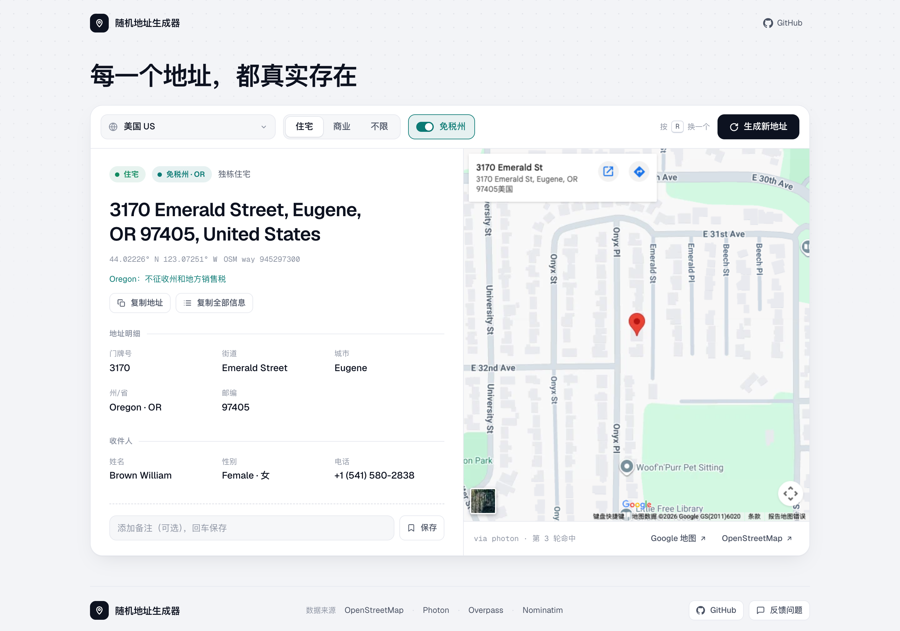
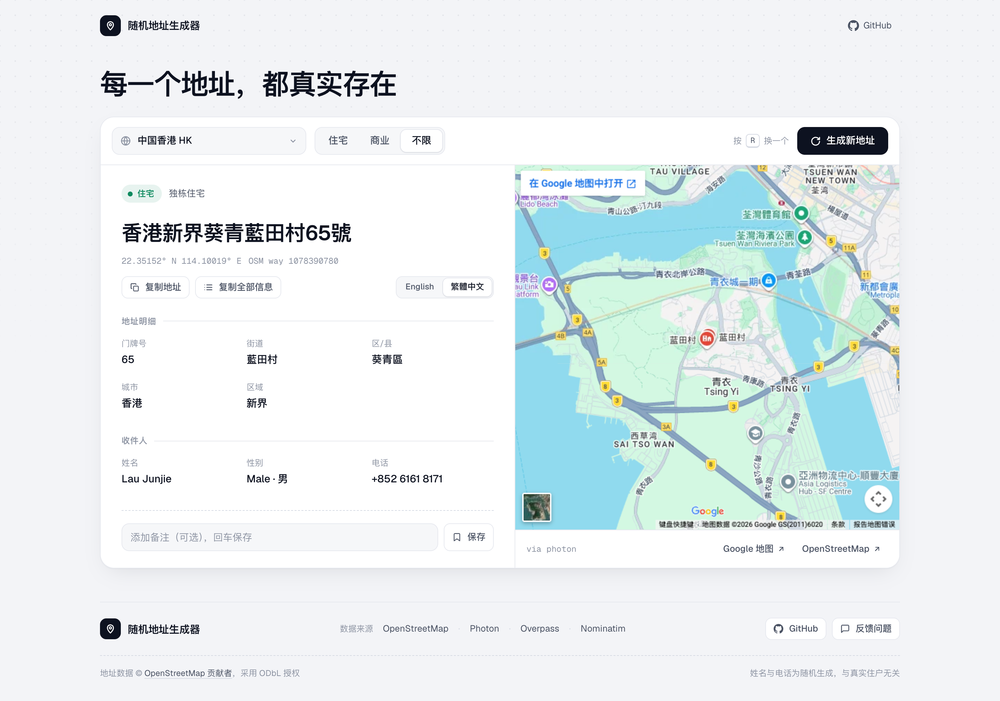

# 随机地址生成器

从 OpenStreetMap 中随机选取**真实存在、带门牌号**的住宅或商业地址，按当地习惯格式化，并配上随机姓名与电话。整个项目只有一个 `worker.js`，复制到 Cloudflare Workers 即可运行。

线上地址：[addr.jiangnan24.com](https://addr.jiangnan24.com/)



<table>
  <tr>
    <td width="68%"></td>
    <td width="32%"></td>
  </tr>
  <tr>
    <td align="center">深色模式 · 中国商业地址</td>
    <td align="center">手机端 · 日本住宅地址</td>
  </tr>
</table>



## 功能

- **真实地址**：只返回 OpenStreetMap 中带门牌号的建筑或商户，可在 OpenStreetMap 上直接查看
- **住宅 / 商业 / 不限**：按 OSM 标签区分住宅楼（`building=apartments/house/...`）、商户（商店、餐饮、酒店、办公等）和公共设施
- **按当地习惯格式化**：

  | 地区 | 格式 | 示例 |
  | --- | --- | --- |
  | 中国 | 省 + 市 + 区县 + 路 + 号 | 四川省成都市金牛区二环路北三段114号 |
  | 台湾 | 郵遞區號 + 縣市 + 區 + 路段 + 號 | 110臺北市信義區基隆路一段172巷3號 |
  | 日本 | 〒邮编 + 都道府县 + 市区町村 + 町丁目 + 番-号 | 〒150-0012 東京都渋谷区広尾五丁目2-18 |
  | 韩国 | 시/도 + 구/군 + 도로명 + 건물번호 | 서울특별시 성북구 성북로 77 |
  | 香港 | 英文或繁体中文，含香港岛 / 九龙 / 新界 | 662 Nathan Road, Mong Kok, Kowloon, Hong Kong<br>香港九龍旺角彌敦道662號 |
  | 美国 | 门牌 街道, 城市, 州缩写 邮编 | 3170 Emerald Street, Eugene, OR 97405 |

- **美国免税州**：可只在不征收州销售税的五个州（俄勒冈 OR、特拉华 DE、新罕布什尔 NH、蒙大拿 MT、阿拉斯加 AK）的 12 个主要城市中生成，并标注免税说明
- **本地电话格式**：各国按当地手机号格式生成；美国按地址所在城市匹配区号（如旧金山 415/628、蒙大拿 406），巴西按城市匹配地区码（圣保罗 11、里约 21）
- **结构化字段**：门牌号、街道、区/县、城市、州/省、邮编分别列出，点击即可复制
- **地图预览**：Google 地图定位到该地址，另附 OpenStreetMap 链接和经纬度
- **收藏**：地址可加备注保存在浏览器本地
- 支持深色模式与手机端，按 <kbd>R</kbd> 快速换一个地址

支持 24 个国家/地区：美国、英国、法国、德国、中国、中国台湾、中国香港、日本、印度、澳大利亚、巴西、加拿大、俄罗斯、南非、墨西哥、韩国、意大利、西班牙、土耳其、沙特阿拉伯、阿根廷、埃及、尼日利亚、印度尼西亚。

## 部署到 Cloudflare Workers

`worker.js` 无需任何依赖、配置或绑定，两种方式任选其一：

**控制台**：在 Cloudflare 控制台创建一个 Worker，打开代码编辑器，把 [worker.js](https://raw.githubusercontent.com/jiangnan1224/AddressGenerator/refs/heads/feature/real-addresses/worker.js) 的全部内容粘贴进去并部署。

**命令行**：

```bash
npx wrangler deploy worker.js --name address-generator --compatibility-date 2025-09-01
```

## 本地验证

`local.html` 会直接加载 `worker.js`，在浏览器中模拟 Worker 运行，本地看到的就是将要部署的同一份代码。需要通过本地服务器打开（直接双击文件无法加载）：

```bash
python3 -m http.server 8000
```

然后访问 http://localhost:8000/local.html 。

也可以用 Cloudflare 的本地运行时启动：

```bash
npx wrangler dev worker.js --compatibility-date 2025-09-01
```

## 接口

```
GET /api?country=US&type=residential&taxFree=1
```

| 参数 | 说明 |
| --- | --- |
| `country` | 国家/地区代码，如 `US`、`CN`、`JP`、`HK`，默认 `US` |
| `type` | `residential`（住宅）、`commercial`（商业）或 `any`（不限），默认 `any` |
| `taxFree` | 传 `1` 时只在美国免税州生成，仅对 `country=US` 有效 |

返回示例：

```json
{
  "name": "Brown William",
  "gender": "Female",
  "phone": "+1 (541) 580-2838",
  "address": "3170 Emerald Street, Eugene, OR 97405, United States",
  "addressParts": {
    "houseNumber": "3170",
    "street": "Emerald Street",
    "city": "Eugene",
    "state": "Oregon",
    "stateCode": "OR",
    "postcode": "97405",
    "country": "United States"
  },
  "type": "residential",
  "category": "building=house",
  "placeName": "",
  "coordinates": { "lat": 44.02226, "lng": -123.07251 },
  "taxFree": { "code": "OR", "name": "Oregon", "note": "不征收州和地方销售税" },
  "osmUrl": "https://www.openstreetmap.org/way/945297300",
  "source": "photon",
  "rounds": 3
}
```

- `type`：`residential` 住宅、`commercial` 商业、`public` 公共设施、`unspecified` 只有门牌但未标注用途
- `taxFree`：美国地址位于免税州时返回，否则为 `null`
- `localized`：仅香港地址返回，包含 `en`（英文）和 `zh`（繁体中文）两个版本，街道缺少某种语言名称时该版本为 `null`
- 找不到地址时返回 HTTP 503，`details` 中列出每一步失败的原因

## 工作原理

1. 在所选国家的预设城市附近取一个随机点
2. 用 [Photon](https://photon.komoot.io/) 查询附近带门牌号的对象，并按标签筛选住宅或商业；Photon 不可用时回退到 [Overpass API](https://overpass-api.de/)
3. 缺少城市、邮编或区县时，用 [Nominatim](https://nominatim.org/) 补全
4. 从候选中随机挑选一个，按国家整理字段并格式化，再配上随机姓名和电话

单次请求最多尝试 6 轮、总耗时不超过 25 秒。

## 注意事项

- 地址数据来自 OpenStreetMap（[ODbL](https://www.openstreetmap.org/copyright) 授权），页面底部保留了署名
- Photon、Overpass、Nominatim 都是免费的公共服务，请遵守各自的使用条款，避免高频调用
- 地址质量取决于当地 OSM 数据的完整度：欧美、日本、港台覆盖较好；部分地区的原始数据可能缺少区县、街道名不规范或邮编有误
- 姓名与电话为随机生成，与该地址的真实住户无关

## 致谢

- [OpenStreetMap](https://www.openstreetmap.org/) 及其贡献者
- [Photon](https://photon.komoot.io/)、[Overpass API](https://overpass-api.de/)、[Nominatim](https://nominatim.org/)
- [Real-Address-Generator](https://github.com/Adonis142857/Real-Address-Generator)

## 许可证

MIT License
